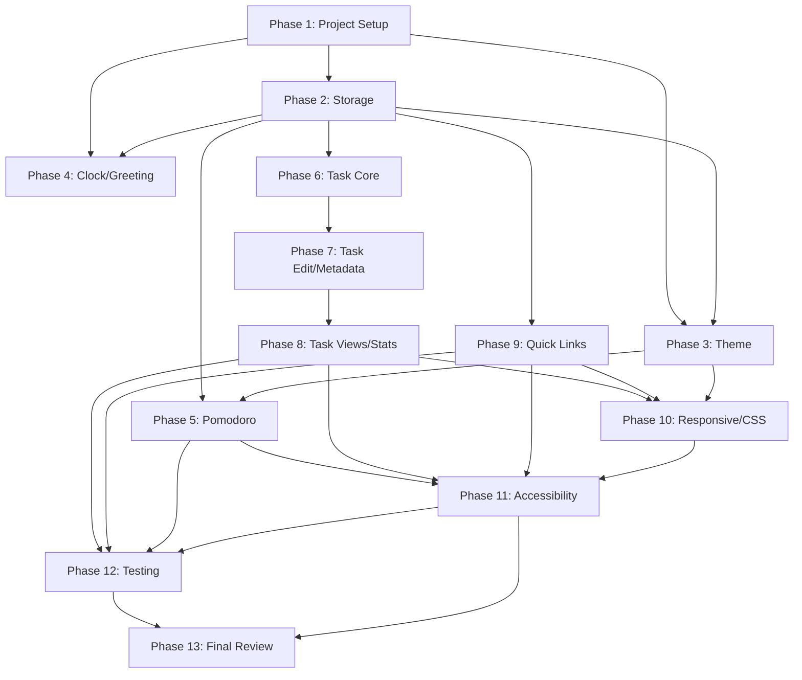

# Implementation Plan

## Overview

This plan builds the Life Dashboard in ordered, verifiable phases. Each phase ends with a checkpoint. Tasks follow the design in `design.md` and fulfill `requirements.md`. Pure, testable logic is kept separate from DOM-dependent rendering so the Phase 12 test harness can exercise it. The project uses pure HTML5, CSS3, and Vanilla JavaScript with no frameworks, no backend, and no build tools, and runs by opening `index.html` directly.

## Tasks

### Phase 1: Project Setup and HTML Foundation

- [x] 1.1 Create the directory structure `life-dashboard/` with `css/` and `js/` subdirectories.
- [x] 1.2 Create `index.html` with semantic landmarks (`<header>`, `<main>`, `<section>` per widget, `<footer>`), a no-flash inline theme script in `<head>`, and `<link>`/`<script>` tags for `css/style.css` and `js/app.js`.
- [x] 1.3 Create `css/style.css` with a base reset, typography, and CSS variables for both light and dark themes scoped under `[data-theme]`, including `--color-primary` (`#635BFF` light / `#8B83FF` dark).
- [x] 1.4 Create `js/app.js` with an IIFE namespace skeleton (`Storage`, `ThemeController`, `ClockGreeting`, `PomodoroTimer`, `TaskManager`, `QuickLinksManager`, `App`) and an `App.bootstrap` entry on `DOMContentLoaded`.
- [x] 1.5 Create `README.md` with an overview, feature list, and instructions to open `index.html` directly.

**Checkpoint:** Open `index.html` directly in a browser; the page loads with no console errors and the correct theme applies without a flash.

### Phase 2: Storage Layer

- [x] 2.1 Define the versioned key constants `lifeDashboard.tasks.v1`, `lifeDashboard.quickLinks.v1`, `lifeDashboard.theme.v1`, and `lifeDashboard.settings.v1`.
- [x] 2.2 Implement `Storage.isAvailable()` using a `localStorage` write/read probe with feature detection.
- [x] 2.3 Implement `Storage.load(key, defaultValue)` that reads, `JSON.parse`s, and returns `defaultValue` on parse failure or missing key.
- [x] 2.4 Implement `Storage.save(key, value)` that `JSON.stringify`s and writes inside a try/catch so quota or availability errors never crash the app.
- [x] 2.5 Implement `Storage.generateId()` returning `crypto.randomUUID()` with a `Date.now()`/`Math.random`/counter fallback.

**Checkpoint:** Saving a value and loading it returns an equivalent value; malformed JSON returns the default; an unavailable `localStorage` falls back to in-memory state.

### Phase 3: Theme Controller

- [x] 3.1 Implement the anti-flash init: read the stored theme or fall back to `prefers-color-scheme`, then set `data-theme` on `<html>` before the body renders (inline script in `<head>`).
- [x] 3.2 Implement the theme toggle button that flips `data-theme` and persists the choice to the theme key.
- [x] 3.3 Apply the theme CSS variables across all components so toggling re-themes the entire UI instantly.

**Checkpoint:** Toggling switches themes and persists across refresh; first visit respects `prefers-color-scheme`; no flash on load. Validates Requirements 23.

### Phase 4: Clock and Greeting

- [x] 4.1 Implement the clock display rendering current time and date, updated every second via `setInterval`.
- [x] 4.2 Implement greeting selection by hour against the Greeting_Hours ranges (Morning 05:00-11:59, Afternoon 12:00-16:59, Evening 17:00-22:59, Late Night 23:00-04:59).
- [x] 4.3 Implement the editable display name: an inline edit affordance that saves to the settings key on confirm and restores the prior value on cancel.
- [x] 4.4 Load the stored display name on startup and include it in the greeting; render without a name when none is stored.

**Checkpoint:** Time and date update live; greeting matches the time of day; the display name persists across refresh. Validates Requirements 1, 2, 3.

### Phase 5: Pomodoro Timer

- [x] 5.1 Implement the target-timestamp countdown: on Start compute `targetEnd = Date.now() + durationMs`; each tick derives `remaining = targetEnd - Date.now()`.
- [x] 5.2 Implement Start, Pause (store `remainingMs`, clear interval), and Reset (restore 25:00) controls.
- [x] 5.3 Implement the `mm:ss` time display refreshed every tick.
- [x] 5.4 Implement the circular progress indicator (SVG ring) whose stroke offset reflects the elapsed fraction.
- [x] 5.5 Implement completion: when `remaining <= 0`, stop the timer, show 00:00, and fire a `Notification` only if `Notification.permission === "granted"` (never request permission); show an in-app indicator otherwise.
- [x] 5.6 Confirm the timer keeps accurate remaining time after tab inactivity and continues running across theme changes without resetting.

**Checkpoint:** Timer counts down accurately, pauses/resets, the ring updates, completion notifies only with granted permission, and the session survives a theme switch and tab inactivity. Validates Requirements 4, 5, 6, 7, 24.

### Phase 6: Task Manager - Core

- [x] 6.1 Implement the Task data model with `id`, `title`, `completed`, `priority`, `category`, `createdAt`, `updatedAt`, `dueDate`, assigning defaults and timestamps on creation.
- [x] 6.2 Implement add-task with duplicate prevention: trim the title, reject empty/whitespace titles, and reject duplicates by case-insensitive trimmed comparison.
- [x] 6.3 Implement safe task rendering using `document.createElement` and `textContent` (no `innerHTML` for titles) with event delegation on the list container.
- [x] 6.4 Implement toggle completion and delete, updating `updatedAt` and persisting the list to storage after each mutation.

**Checkpoint:** Tasks can be added; duplicates and empty titles are rejected; toggling and deleting work and persist across refresh. Validates Requirements 8, 9, 11, 29.

### Phase 7: Task Manager - Editing and Metadata

- [x] 7.1 Implement inline editing: an input pre-filled with the current title; Enter saves (re-validating duplicates among other tasks), Escape cancels and restores the original.
- [x] 7.2 Implement category (Personal/Work/Health/Learning/Other) and priority (low/medium/high) selection and visible display on each task.
- [x] 7.3 Implement due date input and overdue display: mark incomplete tasks with a past due date as overdue, and do not mark completed past-due tasks as overdue.

**Checkpoint:** Tasks can be edited inline with cancel; categories and priorities display; overdue tasks are highlighted and completed past-due tasks are not. Validates Requirements 10, 12, 13.

### Phase 8: Task Manager - Views and Statistics

- [x] 8.1 Implement filters (All/Active/Completed/Today), where Today includes tasks due today plus overdue incomplete tasks.
- [x] 8.2 Implement sorting (manual/newest/oldest/priority/due-date) with undated tasks placed last in due-date sort.
- [x] 8.3 Implement case-insensitive search on titles, composed with the active filter.
- [x] 8.4 Implement statistics: total, active, completed counts and completion percentage (0 on empty list).
- [x] 8.5 Implement empty-state and all-complete-state messages.

**Checkpoint:** Filters, sorts, and search update the view without losing data; statistics are accurate; empty and all-complete states render. Validates Requirements 14, 15, 16, 17, 18.

### Phase 9: Quick Links

- [x] 9.1 Implement default link seeding (Google, YouTube, GitHub, Gmail, Notion) only when the key is absent.
- [x] 9.2 Implement add/edit/delete for quick links with persistence.
- [x] 9.3 Implement URL validation accepting only `http:`/`https:` via the `URL` constructor; reject `javascript:`, `data:`, `file:`, and protocol-less inputs with an inline error and do not save.
- [x] 9.4 Implement rendering links with `target="_blank"` and `rel="noopener noreferrer"`, setting `href` via the DOM API.

**Checkpoint:** Defaults appear on first load; CRUD works; invalid URLs are rejected; links open in a new tab safely. Validates Requirements 19, 20, 21, 22.

### Phase 10: Responsive Layout and CSS Polish

- [x] 10.1 Implement the multi-column grid layout for viewports wider than 1024px.
- [x] 10.2 Implement the tablet layout for 768-1024px viewports.
- [x] 10.3 Implement the single-column mobile layout for viewports under 768px.
- [x] 10.4 Style rounded cards, subtle borders, soft shadows, smooth transitions, and the premium minimalist palette in both themes.
- [x] 10.5 Implement reduced-motion support via `@media (prefers-reduced-motion: reduce)` disabling non-essential animations.

**Checkpoint:** The dashboard reflows correctly across desktop, tablet, and mobile breakpoints with a polished look and reduced-motion behavior. Validates Requirements 27, 28 (layout/motion).

### Phase 11: Accessibility

- [x] 11.1 Add ARIA labels to icon-only controls (theme toggle, edit, delete, timer controls).
- [x] 11.2 Ensure all interactions are keyboard accessible with Enter/Escape handling where applicable.
- [x] 11.3 Verify visible `:focus`/`:focus-visible` states in both themes.
- [x] 11.4 Verify semantic HTML landmarks and an aria-live region for timer completion.

**Checkpoint:** Every feature is reachable and operable by keyboard; controls are announced and visibly focused in both themes. Validates Requirements 28.

### Phase 12: Testing and Verification

- [x] 12.1 Create a lightweight in-browser test harness (`tests/test.html`) that loads `js/app.js` and runs assertions against exposed pure logic, with no build step or external runner.
- [x] 12.2 Write a storage round-trip property test: save then load returns an equivalent value for each versioned key.
- [x] 12.3 Write a duplicate-prevention property test: adding a normalized duplicate does not change the list length.
- [x] 12.4 Write a URL-validation property test: only `http:`/`https:` URLs are accepted; `javascript:`, `data:`, `file:`, and protocol-less inputs are rejected.
- [x] 12.5 Write a sorting-stability property test: due-date sort places `dueDate === null` tasks last; manual sort preserves insertion order across repeated re-sorts.
- [x] 12.6 Write an idempotent-toggling property test: toggling completion twice restores the original value and preserves other fields.
- [x] 12.7 Write a safe-rendering property test: titles with `<`, `>`, `&`, or quotes render as literal text with no added child elements.
- [x] 12.8 Write integration smoke tests (1-2 examples each): initial render shows default quick links, empty task state renders, and the correct theme applies on first load.
- [x] 12.9 Run the full test harness and fix any failures until all tests pass.

**Checkpoint:** All automated property and smoke tests pass. Validates the Correctness Properties in `design.md`.

### Phase 13: Final Review and Edge-Case Verification

- [x] 13.1 Verify every edge case from the requirements: empty task list, all tasks completed, duplicate submission, special characters in titles, cancel editing, invalid URLs, malformed JSON in storage, storage unavailable, tab inactivity during timer, timer reaching zero, theme change during timer, page refresh after saves, filter switching, repeated sorting changes, URLs without protocol, disallowed protocols, and undated tasks in due-date sort.
- [x] 13.2 Confirm the app runs by opening `index.html` directly in a browser with no server or build step, and uses no frameworks or third-party libraries.
- [x] 13.3 Update `README.md` with the final feature set, project structure, and usage notes.

**Checkpoint:** All edge cases are handled gracefully and the app runs standalone by opening `index.html`.

## Task Dependency Graph



Waves group tasks that can execute in parallel; each wave depends only on earlier waves. The task IDs below reference the checkboxes in the Tasks section.

```json
{
  "waves": [
    {
      "wave": 1,
      "tasks": ["1.1", "1.2", "1.3", "1.4", "1.5"],
      "depends_on": []
    },
    {
      "wave": 2,
      "tasks": ["2.1", "2.2", "2.3", "2.4", "2.5"],
      "depends_on": ["1.1", "1.2", "1.3", "1.4"]
    },
    {
      "wave": 3,
      "tasks": ["3.1", "3.2", "3.3", "4.1", "4.2", "4.3", "4.4", "6.1", "6.2", "6.3", "6.4", "9.1", "9.2", "9.3", "9.4"],
      "depends_on": ["2.1", "2.2", "2.3", "2.4", "2.5"]
    },
    {
      "wave": 4,
      "tasks": ["5.1", "5.2", "5.3", "5.4", "5.5", "5.6", "7.1", "7.2", "7.3"],
      "depends_on": ["3.1", "3.2", "6.1", "6.2", "6.3", "6.4"]
    },
    {
      "wave": 5,
      "tasks": ["8.1", "8.2", "8.3", "8.4", "8.5"],
      "depends_on": ["7.1", "7.2", "7.3"]
    },
    {
      "wave": 6,
      "tasks": ["10.1", "10.2", "10.3", "10.4", "10.5"],
      "depends_on": ["3.3", "8.5", "9.4"]
    },
    {
      "wave": 7,
      "tasks": ["11.1", "11.2", "11.3", "11.4"],
      "depends_on": ["5.6", "8.5", "9.4", "10.5"]
    },
    {
      "wave": 8,
      "tasks": ["12.1", "12.2", "12.3", "12.4", "12.5", "12.6", "12.7", "12.8", "12.9"],
      "depends_on": ["5.6", "8.5", "9.4", "11.4"]
    },
    {
      "wave": 9,
      "tasks": ["13.1", "13.2", "13.3"],
      "depends_on": ["11.4", "12.9"]
    }
  ]
}
```

Phase 1 scaffolds the project; Phase 2 builds the storage layer that every data-backed module needs. Theme (Phase 3) and Clock/Greeting (Phase 4) depend on setup and storage and can proceed in parallel. The Pomodoro timer (Phase 5) depends on storage and theme for its continuity property. Task features are sequential (Core 6 → Edit/Metadata 7 → Views/Stats 8); Quick Links (Phase 9) depends only on storage. Responsive/CSS (Phase 10) is applied once the major components exist. Accessibility (Phase 11) and Testing (Phase 12) follow the feature phases, and Final Review (Phase 13) closes the plan.

## Notes

- The project must run from the `file://` protocol, so ES module `import`/`export` is avoided in favor of an IIFE namespace inside a single `js/app.js`.
- Pure logic (storage, duplicate detection, URL validation, sorting, timer math) should be implemented as standalone functions exposed on the namespace so the Phase 12 test harness can exercise them without a build step.
- Default quick links are seeded only when the storage key is absent, so a user who clears the list is not re-seeded.
- The Pomodoro timer never requests notification permission; it only fires `new Notification` when permission is already granted and falls back to an in-app indicator.
- All user-provided text is rendered via `textContent` and DOM methods; `innerHTML` is never used for user content.
